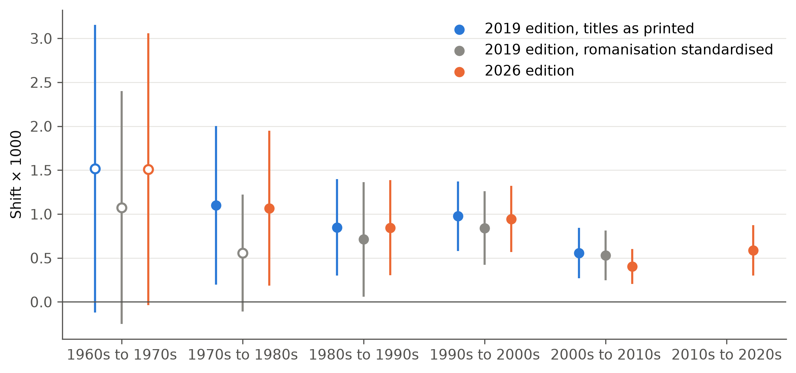

```{=html}
<div class="home">

  <section class="row-s identity" aria-labelledby="who">
    
    <div class="head">
      <div class="name" id="who" role="heading" aria-level="1"><span>Junyoung</span> <span>Baik</span></div>
      <p class="tagline" id="tagline" aria-label="Core competencies: research, translation, editing, data">Research&nbsp;· Translation&nbsp;· Editing&nbsp;· Data</p>
    </div>
    <div class="rest">
      <dl class="info">
        <div><dt class="label">Contact</dt><dd class="contact"><span class="addr" id="email">bjunyoung@gmail.com</span><button class="chip" type="button" id="copy">Copy</button><a href="cv.html">CV</a></dd></div>
        <div><dt class="label">Interests</dt><dd>East Asia&nbsp;· Defense&nbsp;· Policy&nbsp;· Law&nbsp;· Data&nbsp;· History</dd></div>
        <div><dt class="label">Education</dt><dd>M.A., Regional Studies–East Asia, Harvard University, 2024<br>B.A., History, University of Pennsylvania, 2022</dd></div>
        <div><dt class="label">Languages</dt><dd><ul class="langs"><li>English<span>Native</span></li><li>Korean<span>Native</span></li><li>Japanese<span>Advanced</span></li><li>Chinese<span>Intermediate</span></li></ul></dd></div>
      </dl>
    </div>
  </section>

  <section class="row-s" aria-labelledby="about-h">
    <div class="row-label" id="about-h" role="heading" aria-level="2">About</div>
    <div class="row-body">
      <p>I am a multilingual researcher and editor working across East Asian history, defense publishing and data analysis. I hold an M.A. in Regional Studies–East Asia from Harvard University and a B.A. in History from the University of Pennsylvania.</p>
      <p>From 2024 to 2026 I served in the Republic of Korea Air Force as an English translator and editor at the ROKAF History and Archives Management Agency, where I worked on four official defense publications. My work centers on source verification, proofreading and editorial accuracy, together with structured data analysis in Excel and Python. I have also coordinated overseas buyers and distributors for a Korean beauty start-up.</p>
    </div>
  </section>

  <section class="row-s" aria-labelledby="work-h">
    <div class="row-label" id="work-h" role="heading" aria-level="2">Data Analysis</div>
    <div class="work">
      <a class="work-card" href="research/acc-bibliometrics.html">
        <div class="thumb"></div>
        <span class="label">Bibliometrics · Language models · 2026</span>
        <div class="card-title" role="heading" aria-level="3">Re-reading the ACC bibliography</div>
        <p>A rebuild of a 2020 study of Paul R. Goldin's bibliography of Western-language scholarship on ancient China, with a new parser, a full check of both editions and multilingual embeddings.</p>
        <div class="stats"><span><b>16,928</b> entries</span><span><b>+38.6%</b> since 2019</span><span><b>2</b> editions</span></div>
      </a>
      <div class="work-card pending">
        <div class="thumb"><span class="label">In progress</span></div>
        <span class="label">Open data · Alliance analysis</span>
        <div class="card-title" role="heading" aria-level="3">U.S.–ROK Alliance Alignment</div>
        <p>U.S. demands on South Korea set against Korean alignment and delivery, benchmarked against peer U.S. allies.</p>
      </div>
    </div>
  </section>

  <section class="row-s" id="writing" aria-labelledby="w-h">
    <div class="row-label" id="w-h" role="heading" aria-level="2">Writing</div>
    <div class="row-body">
        <ul class="writing-list">
          <li><a href="writing/sool-1763.html"><i>Sŏŏl</i> Interactions with the Japanese <i>Bunjin</i> in 1763 <i>T’ongsinsahaeng</i></a><span class="label">Research excerpt · 2024</span></li>
          <li><span class="pending-title">Late-Ming Demands on Chosŏn and Present U.S. Demands on South Korea</span><span class="label">Policy memo · In progress</span></li>
          <li><span class="pending-title">National Defense Creep and Corporate Governance</span><span class="label">Legal memo · In progress</span></li>
        </ul>
      </div>
  </section>

  <section class="row-s" id="cv" aria-labelledby="cv-h">
    <div class="row-label" id="cv-h" role="heading" aria-level="2">CV</div>
    <div class="row-body cv-links"><a href="cv.html">Read the CV</a><a href="cv.pdf">Download PDF</a><span class="label">Updated October 2026</span></div>
  </section>

</div>

<script>
(() => {
  const el = document.getElementById('tagline');
  const FULL = 'Research · Translation · Editing · Data';
  // Type the line once, then let the caret blink out. Skipped for reduced motion.
  if (!matchMedia('(prefers-reduced-motion: reduce)').matches) {
    el.textContent = '';
    const text = document.createElement('span');
    const caret = document.createElement('span'); caret.className = 'caret'; caret.setAttribute('aria-hidden', 'true');
    el.append(text, caret);
    let i = 0;
    const id = setInterval(() => {
      text.textContent = FULL.slice(0, ++i);
      if (i >= FULL.length) { clearInterval(id); setTimeout(() => caret.classList.add('done'), 2400); }
    }, 55);
  }
  const copy = document.getElementById('copy');
  const email = document.getElementById('email');
  copy.addEventListener('click', () => {
    const select = () => getSelection().selectAllChildren(email);
    if (!navigator.clipboard) return select();
    navigator.clipboard.writeText(email.textContent).then(() => {
      copy.textContent = 'Copied'; setTimeout(() => { copy.textContent = 'Copy'; }, 1600);
    }, select);
  });
})();
</script>
```
