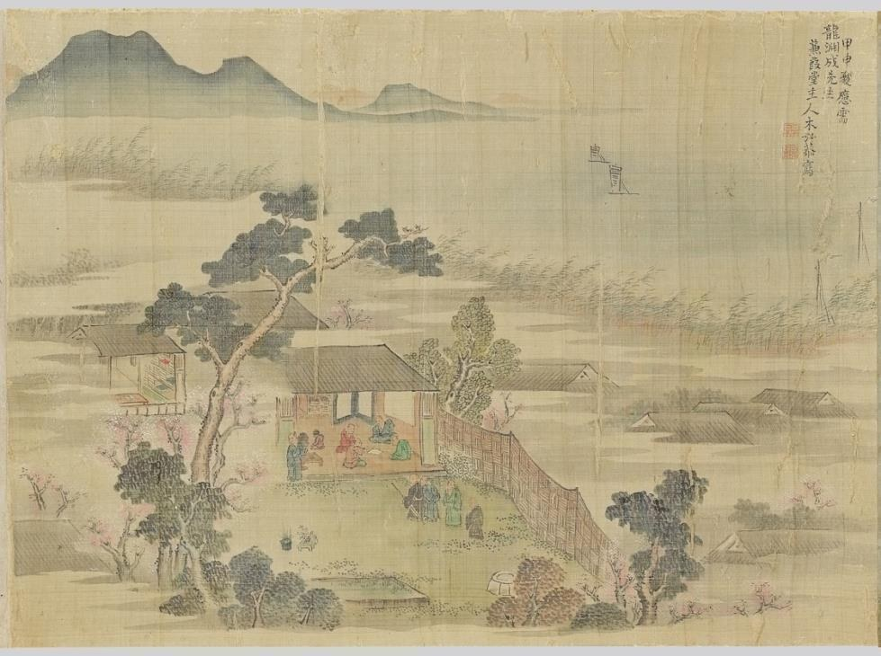

```{=html}
<div class="listing">
  <header class="list-head">
    <div class="list-title" role="heading" aria-level="1">Writing</div>
    <span class="label">1 published · 2 in progress</span>
  </header>

  <a class="tile" href="sool-1763.html">
    <div class="tile-img"></div>
    <div class="tile-body">
      <span class="label">Research excerpt · Harvard M.A. thesis · 2024</span>
      <div class="tile-title" role="heading" aria-level="2"><i>Sŏŏl</i> Interactions with the Japanese <i>Bunjin</i> in 1763 <i>T’ongsinsahaeng</i></div>
      <p>How <i>sŏŏl</i>, secondary-status literati in Chosŏn Korea, used the 1763 diplomatic mission to Tokugawa Japan to build cultural authority, exchange knowledge with Japanese <i>bunjin</i>, and negotiate their position at home.</p>
      <span class="more">Read the excerpt →</span>
    </div>
  </a>

  <div class="tile pending">
    <div class="tile-img"><span class="label">In progress</span></div>
    <div class="tile-body">
      <span class="label">Policy memo · Applied history</span>
      <div class="tile-title" role="heading" aria-level="2">Late-Ming Demands on Chosŏn and Present U.S. Demands on South Korea</div>
      <p>A comparison of late-Ming demands on Chosŏn Korea, c. 1592–1637, with present U.S. demands on South Korea.</p>
    </div>
  </div>

  <div class="tile pending">
    <div class="tile-img"><span class="label">In progress</span></div>
    <div class="tile-body">
      <span class="label">Legal memo</span>
      <div class="tile-title" role="heading" aria-level="2">National Defense Creep and Corporate Governance</div>
      <p>How national defense law interacts with civil and corporate-governance law.</p>
    </div>
  </div>
</div>
```
